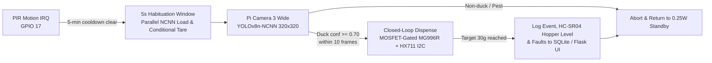

# smart-duck-feeder
Final Year Project (Raspberry Pi 4B, YOLOv8 NCNN, closed-loop dispenser &amp; SQLite/Flask telemetry)
# Smart Duck Feeder: Edge-AI Target Verification & Closed-Loop Dispensing System

An autonomous, solar-powered agricultural feeding system built on a **Raspberry Pi 4B** that eliminates feed waste and pest-borne biosecurity risks. Unlike conventional open-loop timer feeders, this system wakes on thermal motion, verifies target species locally using a custom **5-class YOLOv8-Nano (NCNN)** model, dispenses precise **30 g** portions via closed-loop load-cell feedback, and serves an offline-first **Flask/SQLite** telemetry and fault-diagnostics dashboard over LAN.

---

## Key Engineering Highlights

* **Zero-Cloud Edge AI (327 ms Steady-State Inference):** Fine-tuned a 5-class YOLOv8-Nano detector across **8,703 annotations** (`Duck`, `OtherBird`, `Human`, `FarmAnimal`, `Rodent`) to actively reject chickens, pigeons, and rodents. Exported to **NCNN (320×320)** to leverage ARM Cortex-A72 NEON SIMD vectorization without Docker or cloud dependencies.
* **Multi-Frame Consensus & Habituation Control:** Implements a **5-second startle-suppression delay** (`BIO-01`) while loading NCNN weights into RAM in parallel, followed by a 10-frame verification window ($\ge 0.70$ confidence) that reduces false-negative miss probability to **$2.68 \times 10^{-7}$ (99.99997% effective recall)**.
* **Closed-Loop Precision Dispensing (5.21% CV):** Pairs a high-torque **MG996R** rotary shear gate (4 cm shear radius, $>22\text{ N}$ pellet-jam fracture margin) with an **HX711** load cell (`I²C 0x26`) and conditional taring ($\pm 5\text{ g}$ residual window) to achieve **33.30 g** mean delivery ($\sigma = 1.74\text{ g}$, **57% overshoot reduction**).
* **Ultra-Low Standby Power & MOSFET Isolation:** Uses hardware PIR interrupts (`gpiozero`) instead of camera polling and isolates the servo power rail with an **N-channel MOSFET**, cutting servo quiescent draw from **15 mA to 0.06 mA** and enabling **3+ days** of autonomous operation on a cascaded **27.38 Wh** PiSugar 3 Plus + 10 W solar power architecture.
* **Fault-Tolerant Offline Telemetry:** Logs feed events, median-filtered ultrasonic hopper levels, and hardware exception codes (`ERR_SCALE_TARE`, `ERR_SCALE_DISCONNECT`, `ERR_SCALE_RANGE`, `ERR_ULTRASONIC`) to SQLite with headless `systemd` auto-recovery.

---

## Hardware Architecture & GPIO Pinout

| Subsystem | Component | Interface / GPIO (BCM) | Engineering Notes |
| :--- | :--- | :--- | :--- |
| **Compute** | Raspberry Pi 4B (4GB) | Raspberry Pi OS (64-bit) | Headless `systemd` services; HDMI/BT/USB disabled in standby |
| **Wake Sensor** | HC-SR501 PIR Sensor | `GPIO 17` (Rising-Edge IRQ) | Wakes detector subprocess; enforces 5-min anti-monopolization cooldown |
| **Vision** | Pi Camera Module 3 Wide | MIPI CSI-2 | Captures frames for local NCNN inference |
| **Load Cell** | HX711 Mini Scale (5 kg) | `GPIO 2` (SDA), `GPIO 3` (SCL) | I²C addr `0x26`; **0.52 g RMS error** (99% trials within $\pm 1.0\text{ g}$) |
| **Actuator** | MG996R Metal-Gear Servo | `GPIO 18` (PWM) | Powered by dedicated 6V pack; common ground with Pi |
| **Power Gate** | N-Channel MOSFET + 10 k$\Omega$ | `GPIO 23` | Cuts 15 mA servo standby drain to 0.06 mA |
| **Hopper Level** | HC-SR04 Ultrasonic | `GPIO 24` (TRIG), `GPIO 25` (ECHO) | 1 k$\Omega$ / 2 k$\Omega$ voltage divider (5V $\rightarrow$ 3.33V); 5-sample median filter |
| **Power Supply** | PiSugar 3 Plus + 10W Solar | I²C Battery Telemetry (`:8423`) | 5,000 mAh UPS + 2,400 mAh MPPT manager (27.38 Wh total) |

---

## Experimental Validation & Benchmarks

### 1. Multi-Class Edge AI Detection (Test Set: 704 Images / 1,876 Annotations)
| Class | Precision | Recall | mAP@50 | mAP@50–95 | Operational Role |
| :--- | :---: | :---: | :---: | :---: | :--- |
| **Duck** | **73.14%** | **77.98%** | **81.26%** | **51.99%** | Primary target verification ($\ge 0.70$ threshold) |
| **OtherBird** | **86.05%** | 60.20% | 71.81% | 44.66% | Rejects chickens, crows, and pigeons |
| **Rodent** | 73.35% | **72.73%** | **77.77%** | **52.95%** | Blocks rats/mice biosecurity threats |
| **Human** | 80.57% | 59.82% | 67.83% | 38.92% | Prevents false triggers during manual refills |
| **FarmAnimal** | 67.75% | 39.87% | 49.65% | 31.44% | Rejects non-target livestock |

### 2. Closed-Loop Dispensing Convergence ($n = 100$ Per-Pulse & 40 Multi-State Trials)
| Configuration | Mean Final Mass (Target: 30 g) | Std Dev ($\sigma$) | Coefficient of Variation (CV) | Systematic Offset |
| :--- | :---: | :---: | :---: | :---: |
| **Pre-Tune (Open-Loop Baseline)** | 37.60 g | 6.53 g | 17.36% | +7.60 g |
| **Post-Tune (Closed-Loop HX711)** | **33.30 g** | **1.74 g** | **5.21%** | **+3.30 g (-57%)** |

 ---



## Key Engineering Results

| Metric | Result | Engineering Details |
| :--- | :--- | :--- |
| **Edge AI Inference Latency** | **327 ms** steady-state | Custom 5-class YOLOv8n (`Duck`, `OtherBird`, `Human`, `FarmAnimal`, `Rodent`) exported to NCNN for ARM NEON |
| **Target Detection Accuracy** | **81.26% mAP@50** | Trained on **8,703 annotations**; 10-frame verification reduces miss probability to **$2.68 \times 10^{-7}$** |
| **Closed-Loop Dispensing** | **5.21% CV** (33.30 g mean) | Reduced overshoot by **57%** vs. open-loop baseline; **0.52 g RMS** load-cell error against reference scale |
| **Standby Power Optimization** | **0.06 mA** servo draw | N-channel MOSFET (`GPIO 23`) cuts 15 mA servo idle drain; 27.38 Wh PiSugar 3 Plus + 10 W solar supply |
| **Fault Tolerance** | **Zero silent failures** | Watchdog exception logging (`ERR_SCALE_TARE`, `ERR_SCALE_RANGE`, `ERR_ULTRASONIC`) with `systemd` auto-restart |

## Repository Structure

* `initial_code_v2.py` — Event-driven PIR interrupt wake controller (`gpiozero`) enforcing the 5-minute anti-monopolization cooldown.
* `duckdetector_v4.py` — Core state machine handling parallel NCNN model loading, multi-frame verification, conditional taring (±5 g), closed-loop pulse dispensing, and median-filtered ultrasonic hopper telemetry.
* `app_v3.py` — Offline-first Flask web server and SQLite backend serving live feed logs, hopper capacity, PiSugar battery telemetry, and hardware fault diagnostics.
* `duck-detector-v2_ncnn_model/` & `duck-detector-v2.pt` — Fine-tuned YOLOv8-Nano weights and ARM-optimized NCNN deployment artifacts.
* `static/` & `templates/` — Local dashboard frontend assets (no external CDN dependency).

## Hardware Pinout Layout (Raspberry Pi 4B — BCM)

| Component | BCM Pin(s) | Protocol / Electrical Notes |
| :--- | :--- | :--- |
| **HC-SR501 PIR Motion Sensor** | `GPIO 17` | Rising-edge hardware interrupt (`gpiozero`) |
| **HX711 Mini Scale (5 kg Load Cell)** | `GPIO 2` (SDA), `GPIO 3` (SCL) | I²C interface (`0x26`) |
| **MG996R High-Torque Servo** | `GPIO 18` | 50 Hz PWM signal (dedicated 6 V AA battery pack, shared ground) |
| **N-Channel MOSFET Power Gate** | `GPIO 23` | 10 kΩ series gate resistor; isolates servo power rail in standby |
| **HC-SR04 Ultrasonic Sensor** | `GPIO 24` (TRIG), `GPIO 25` (ECHO) | 1 kΩ / 2 kΩ voltage divider stepping 5 V ECHO down to 3.33 V |
| **Pi Camera Module 3 Wide** | MIPI CSI-2 | Captures 320×320 RGB frames for local NCNN inference |
| **PiSugar 3 Plus + 10 W Solar** | Pogo Pins / TCP `:8423` | 5 V / 3 A UPS supply with live battery percentage polling |

## Running the System

```bash
# Start the local LAN telemetry dashboard (http://<pi-ip>:5000)
python3 app_v3.py

# Start the PIR wake-on-motion controller
python3 initial_code_v2.py
```
